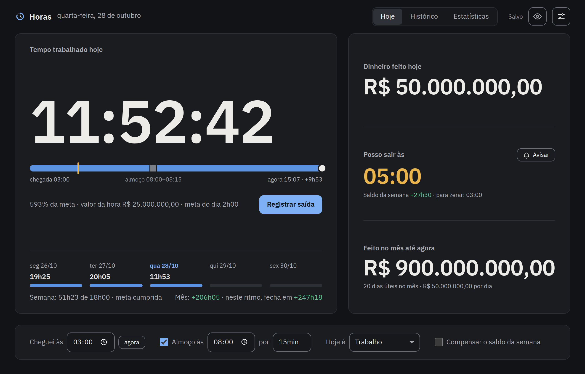
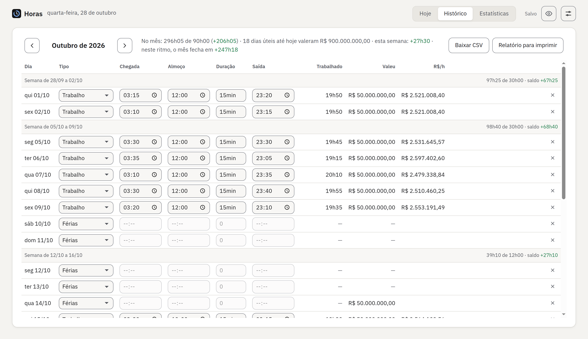
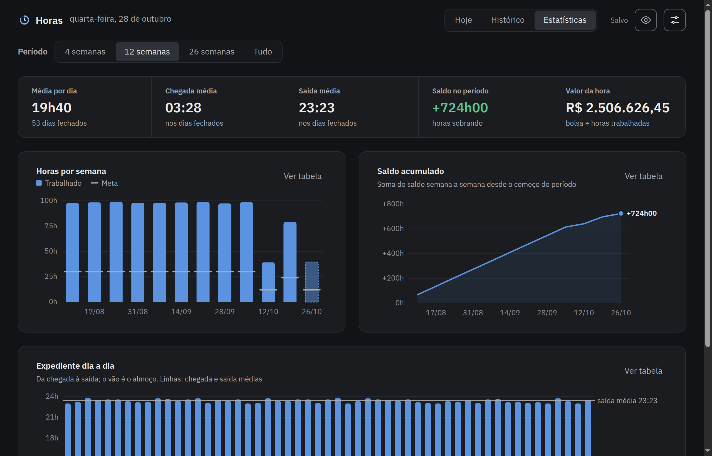
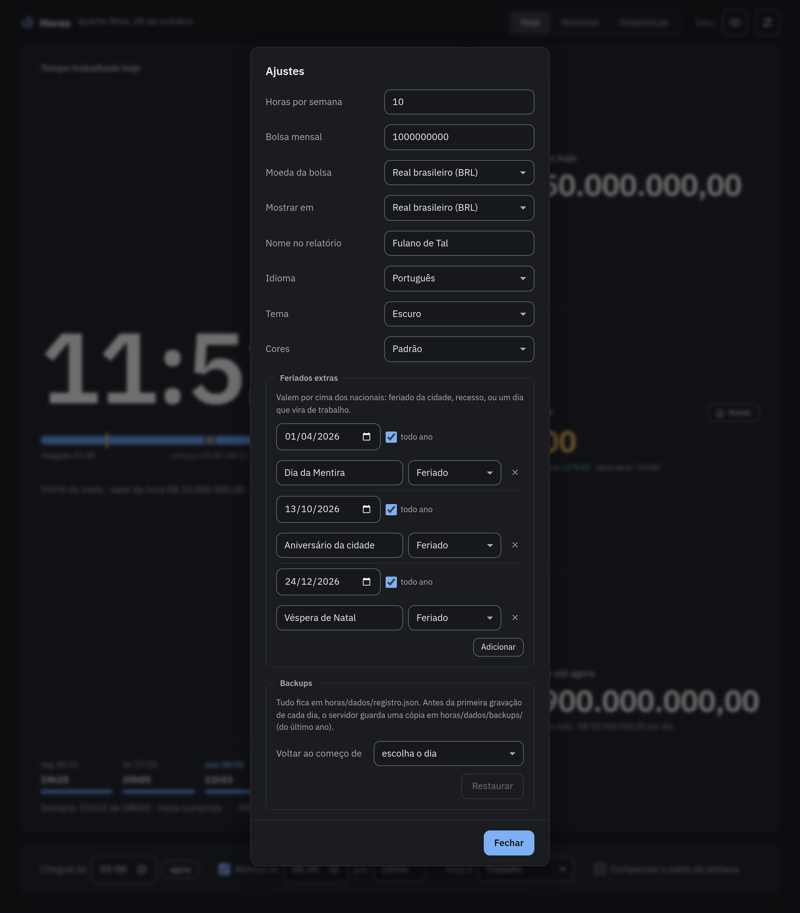

# Horas

**Quanto já trabalhei hoje, que horas posso sair e quanto a bolsa já rendeu no
mês, num relance.** Horas é um controle de ponto pessoal para quem tem meta de
horas por semana e uma bolsa ou salário mensal. Roda no seu computador, sem
conta, sem nuvem e sem anúncio.



<sub>Dados fictícios e exagerados de propósito: ninguém chega às 3 da manhã nem ganha R$ 50 milhões por dia. Ainda.</sub>

## O que faz

- **Relógio do dia.** Mostra o tempo trabalhado ao vivo, com a linha do tempo
  da chegada, do almoço e de agora.
- **"Posso sair às".** Calcula a hora de sair para bater a meta do dia, ou para
  zerar o saldo da semana se você quiser compensar horas a mais ou a menos. Um
  aviso do sistema aparece na hora certa.
- **Dinheiro em tempo real.** Mostra quanto a bolsa rendeu hoje e no mês e o
  valor da sua hora.
- **Saldo da semana e do mês.** Mostra quanto falta para a meta da semana, por
  dia, e como o mês fecha se você mantiver o ritmo.
- **Histórico.** Todos os dias, editáveis, cada um marcado como trabalho,
  folga, férias, atestado ou feriado. Exporta para CSV.
- **Estatísticas.** Horas por semana contra a meta, saldo acumulado e o
  expediente dia a dia, em 4, 12 ou 26 semanas ou tudo. Cada gráfico tem uma
  versão em tabela.
- **Feriados prontos.** Já conhece os feriados nacionais do Brasil, inclusive
  Carnaval, Sexta-feira Santa e Corpus Christi. Os da sua cidade e os recessos
  você acrescenta em Ajustes.
- **Real ou dólar.** Recebe em uma moeda e mostra em outra, pela cotação do dia.
- **Português ou inglês**, com datas, horas e números no formato de cada um.
- **Tema claro, escuro ou automático**, e um modo de cores para daltonismo
  (paleta Okabe–Ito). O saldo também tem sinal e o gráfico tem contorno, então
  a cor nunca é a única pista.
- **Ocultar valores.** Um clique troca todo o dinheiro por •••••, para abrir a
  tela perto de outras pessoas.
- **Funciona sem o servidor.** A página abre mesmo com o servidor desligado e
  guarda tudo no navegador. Quando o servidor volta, os dados sobem sozinhos.
  Dá para instalar como aplicativo pelo Chrome.

## Telas

**Histórico**: cada dia editável, com o tipo, o almoço, o valor do dia e o saldo de cada semana.



**Estatísticas**: médias do período, horas por semana contra a meta, saldo acumulado e o expediente dia a dia.



**Ajustes**: meta da semana, bolsa, moedas, idioma, tema, cores para daltonismo, feriados extras e backups.



## Seus dados ficam com você

- Tudo fica em um arquivo, `dados/registro.json`, na sua máquina.
- O servidor só atende o próprio computador (127.0.0.1) e só a própria página.
  Outros sites não leem nem gravam nada.
- Antes da primeira gravação de cada dia, o servidor faz um backup. As cópias
  do último ano ficam em `dados/backups/`, e dá para voltar a qualquer dia
  pelos Ajustes.
- A única ida à internet é a cotação do dólar, uma vez por dia, em
  `open.er-api.com`. Ela não leva nenhum dado seu.
- Nada para instalar além do Python: o servidor usa só a biblioteca padrão.

## Limites

- **Uma pessoa, um computador.** Não abre no celular nem em outra máquina e
  não sincroniza entre computadores.
- **Semana de segunda a sexta.** Sábado e domingo são folga, a não ser que você
  marque o dia como de trabalho.
- **Só feriados nacionais do Brasil.** Os municipais e estaduais entram à mão,
  uma vez, em Ajustes.
- **Só real e dólar, só português e inglês.**
- **A bolsa muda do mês do ajuste em diante.** Os meses anteriores ficam com o
  valor antigo, e não há como corrigir um mês já encerrado.
- **Cotação de hoje para tudo.** Com "Mostrar em" numa moeda diferente da
  bolsa, meses passados também são convertidos pela cotação do dia.
- **Sem internet, vale a última cotação guardada.** Sem nenhuma, os valores
  ficam na moeda da bolsa.

## Onde foi testado

| | Versão |
|---|---|
| Sistema | Ubuntu 24.04 LTS |
| Python | 3.12 |
| Navegador | Google Chrome 156, também sem janela (headless) |

## Instalar no Linux

Precisa de `git`, `python3` e um navegador atual.

**1. Baixe.** O serviço espera a pasta em `~/Documentos/horas`:

```sh
git clone https://github.com/GuiAzevedo04/ponteiro.git ~/Documentos/horas
```

Para usar outra pasta, troque o caminho na linha `ExecStart` de
`autostart/horas.service` antes do passo 3.

**2. Experimente.**

```sh
cd ~/Documentos/horas
python3 servidor.py
```

Abra http://localhost:8765. Para parar, use Ctrl+C.

**3. Ligue o serviço**, para o servidor subir sozinho toda vez que você entrar
na sessão e voltar se cair:

```sh
mkdir -p ~/.config/systemd/user
cp autostart/horas.service ~/.config/systemd/user/
systemctl --user daemon-reload
systemctl --user enable --now horas.service
```

**4. Instale como aplicativo (opcional).** No Chrome, abra
http://localhost:8765 e use o ícone de instalar na barra de endereço. A página
vira uma janela própria, com ícone no menu.

### No dia a dia

| Para | Comando |
|---|---|
| Ver se está rodando | `systemctl --user status horas.service` |
| Ver o registro do servidor | `journalctl --user -u horas.service -n 50` |
| Atualizar | `git -C ~/Documentos/horas pull && systemctl --user restart horas.service` |
| Usar outra porta | acrescente `Environment=HORAS_PORTA=8800` em `[Service]` no `horas.service` |
| Desligar de vez | `systemctl --user disable --now horas.service` |

## Licença

MIT, em `LICENSE`. A fonte IBM Plex Sans vem junto em `pagina/fontes/`, sob a
licença OFL (`pagina/fontes/OFL.txt`).
